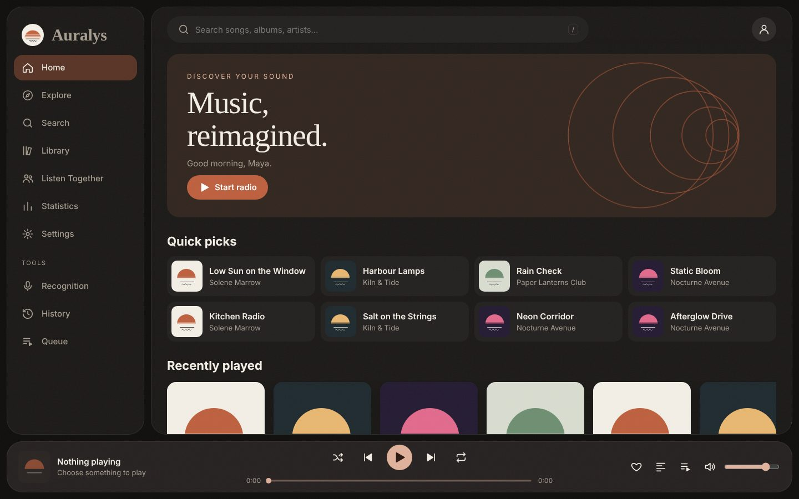
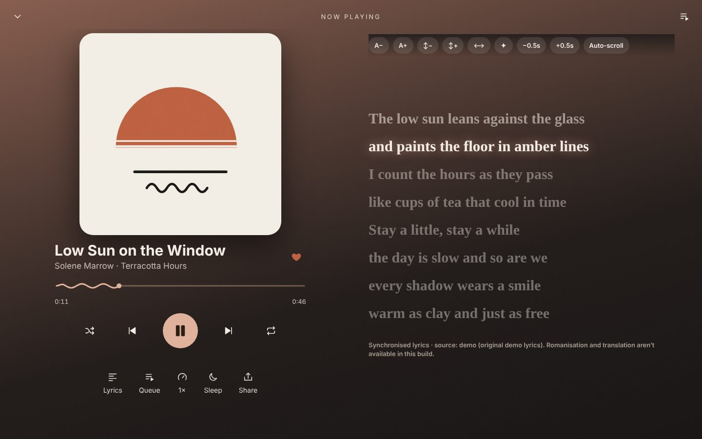
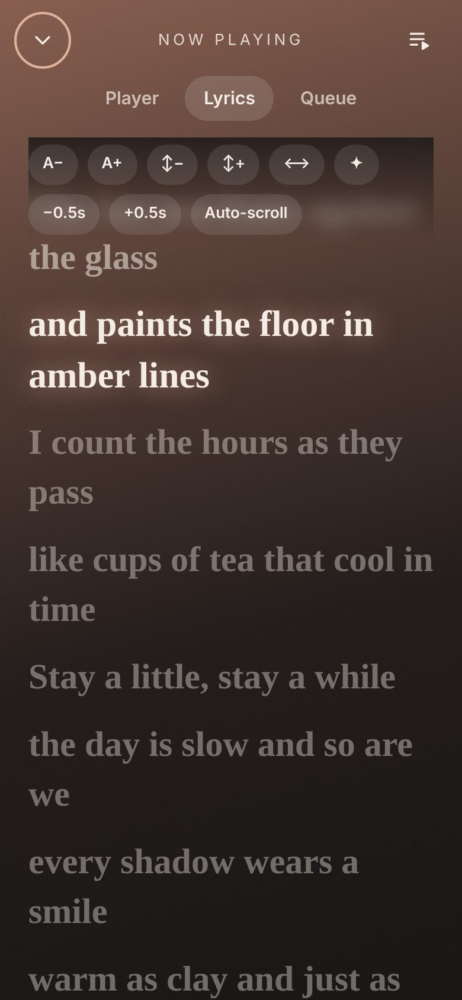

# Auralys Web

A full-stack music web app (and installable PWA) inspired by the feature set of **Auralys 4.1.0 Final** for Android.
It plays **licensed/demo audio and audio you upload yourself**, with accounts, a real library, playlists, a persistent
queue, synchronised lyrics, a 10-band equalizer, crossfade, sleep timer, listening statistics, **real-time listening rooms**,
recognition and optional integrations — each one behind an honest "configured / not configured" state.

> **Honesty notes.** The reference assets are extracted from the APK (not screenshots) and the native layouts were never
> verified, so the UI here is an adaptation guided by the supplied concept art (dark charcoal + terracotta, serif editorial
> headlines, sun-and-waves identity). No code from the APK is used. No third-party catalogue, YouTube stream extraction,
> token solving or download-bypass code exists in this repository. The built-in music is **original, procedurally
> generated demo audio** with original lyrics, labelled "Demo" everywhere it appears.



## Quick start

Requires **Node ≥ 22.13** (uses the built-in `node:sqlite`). One runtime dependency: `ws`.

```bash
npm install
cp .env.example .env      # optional: integrations (see "Configuration")
npm start                 # http://localhost:3000
```

On first start the server creates `data/auralys.db`, applies `migrations/*.sql`, and generates the demo catalogue
(16 tracks, 4 albums, 4 artists, 1 podcast — about 5 s, ~75 MB in `data/media`, git-ignored).
Create an account on `/login` to unlock the library, playlists, statistics and rooms.

```bash
npm test            # 17 unit/integration tests (node:test) — all passing
npm run test:e2e    # 38 Playwright tests (desktop + mobile) + 15 YouTube-integration tests (mocked Google) — all passing
npm run screenshots # regenerates docs/screenshots/*.png from the running app
```

## Implementation plan (as built)

1. **Foundation** — design tokens (light cream / dark / pure black / glass, 4 accents + dynamic), responsive shell
   (sidebar → rail → bottom nav + safe areas), router, store, provider-style API layer.
2. **Playback engine** — one global engine (two `<audio>` elements → Web Audio graph) so playback survives navigation.
3. **Screens** — Home, Explore/Charts/Moods/New releases, Search, Library (+ upload), Album/Artist/Playlist/Podcast,
   full player, Lyrics, Queue, Statistics, History, Recognition, Listen Together, Settings (13 sections), Account, legal.
4. **Backend** — HTTP API, SQLite schema with FKs/indexes/unique constraints, sessions, uploads with magic-byte checks,
   WebSocket rooms, listening-event ingestion with de-duplication.
5. **PWA** — manifest, service-worker app shell, offline start-up, Media Session.
6. **Verification** — unit tests, Playwright e2e on both viewports, screenshots, overflow checks.

## Architecture & deviations from the brief

| Brief suggestion | What was built | Why |
|---|---|---|
| Next.js + Tailwind + Zustand + TanStack Query | Dependency-free ES-module SPA (no build step) | The repository already used plain JS; the brief says to prefer the existing stack. |
| Supabase Postgres/Auth/Realtime + RLS | Node HTTP server + **SQLite** + `ws`, scrypt password hashing, HTTP-only session cookies | Runs anywhere with zero services. Row isolation is enforced in the API layer (every user-owned query is scoped by `user_id`/`owner_id`) and covered by `tests/unit/api.test.js` and the e2e "account isolation" test. A Postgres port needs the migration translated and RLS policies added. |
| IndexedDB for offline files | Server-side uploads; `localStorage` for queue/prefs; Cache Storage for the app shell | Audio is not downloaded for offline use (see limits). |

```
server/   index.js (static+SPA+CSP)  api.js (routes)  rooms.js (WebSocket)  db.js (migrations)  synth.js+seed.js (demo audio)
migrations/001_init.sql   profiles/tracks/albums/artists/playlists/favorites/listening_events/rooms/…
public/   index.html  css/app.css  js/{core,player,ui,views}  sw.js  manifest.webmanifest
tests/    unit/*.test.js  e2e/{run,screenshots,helpers}.cjs
```

* **Provider boundaries** — catalogue/search/lyrics/recognition/AI/scrobbling are separate server modules behind
  `/api/*`; the client only knows URLs. Adding a licensed catalogue means filling the `tracks` table (or a provider that
  returns the same track shape) — the player, queue, lyrics, rooms and stats need no changes.
* **Lyrics** come only from: lyrics you attach to your own uploads (LRC or plain), and the demo tracks' original lyrics.
  If none exist the UI says "Lyrics unavailable" — nothing is generated.
* **Listening statistics** are computed server-side from `listening_events`. The client sends heartbeats keyed by a
  per-play `session_id`; the DB upserts (`UNIQUE(user_id, session_id)`, `MAX(listened_ms)`), so heartbeats and retries
  never double count. A *play* = ≥30 s or ≥50 % of the track.
* **Listen Together** — host owns an authoritative `{queue,index,playing,pos,at}` state; listeners estimate the server
  clock offset from lowest-RTT pings, compute the expected position, and correct drift > 0.4 s every 1.5 s. Sockets
  reconnect with exponential back-off and re-sync from the `welcome` message. Listeners keep independent volume. Rooms
  only accept shared-catalogue tracks (never private uploads) and **no audio is relayed**: each listener streams it.
* **Security** — strict CSP, `X-Content-Type-Options`, custom-header CSRF check on every write, rate limits (login,
  signup, uploads, AI, recognition, joins), upload magic-byte sniffing + size caps, metadata sanitising, text rendered
  via DOM APIs (no `innerHTML` with data), path-traversal guard, secrets server-side only, OAuth `state` verified.

## Configuration (`.env.example`)

| Variable | Enables | Status |
|---|---|---|
| `ANTHROPIC_API_KEY`, `AI_MODEL` | AI playlist suggestions (consent-gated, rate-limited, output validated against real track IDs) | Implemented; **not exercised against the live API** (no key). The "not configured" path is tested. |
| `LASTFM_API_KEY`, `LASTFM_SHARED_SECRET`, `PUBLIC_URL` | Last.fm connect (OAuth state check) + scrobbling | Implemented; **not tested against Last.fm**. |
| `YOUTUBE_API_KEY` | **YouTube as a music source**: search, trending by region, durations/thumbnails via the official YouTube Data API v3; playback via YouTube's official IFrame player | Implemented and tested against a **mock** of the Data API and a **fake IFrame player** — **never run against real YouTube** (no key / no network in CI). |
| `AUDD_API_TOKEN` | Music recognition via AudD | Implemented; **not tested against AudD**. Without it the page says so and only offers a microphone test. |
| `NODE_ENV=production` | `Secure` cookie flag (serve over HTTPS) | |

## YouTube / YouTube Music as the data source

YouTube Music has **no public API**, and its internal endpoints and stream URLs may not be used by third parties. Auralys therefore
uses only what YouTube officially provides:

* **Metadata** — YouTube Data API v3 (`search` with the Music category, `videos.list` for durations and `embeddable`, and
  `chart=mostPopular` for regional trending). Set `YOUTUBE_API_KEY` (free quota is 10 000 units/day; a search costs ~100, so results
  are cached for 10 minutes and requests are rate-limited). Non-embeddable and very short videos are filtered out.
* **Playback** — YouTube's official IFrame Player API, shown in a visible card (YouTube policy) that docks over the artwork in the full
  player. The user consents once before the embed loads (it contacts YouTube/Google); consent can be revoked in Settings → Integrations.
* **Saving** — liking or adding a YouTube track to a playlist makes the **server re-fetch the metadata itself** and store it
  (`tracks.provider='youtube'`, no audio). Clients can't inject metadata. History/statistics, Last.fm scrobbling and rooms work with
  these tracks; rooms let each listener play the video in their own embed.
* **Consequences you should expect:** no equalizer / normalisation / crossfade / visualiser, no background or offline playback, no lyrics
  (Auralys doesn't scrape any), YouTube's ads and terms apply, and some videos refuse embedding (the UI shows the reason).
* **Not done on purpose:** scraping YouTube Music, `ytmusicapi`/innertube, token solvers, `yt-dlp`-style extraction or downloads.

## Not supported / config-required (explicit list)

* **No built-in commercial catalogue.** Without `YOUTUBE_API_KEY` there is only demo audio + your uploads. With it, YouTube is
  available as described above — not verified against the live service.
* **Discord Rich Presence**: impossible from a browser; not implemented. **Android Auto**: native-only; Media Session
  (lock screen, headset and media keys) is used instead.
* **Romanisation / lyric translation**: not implemented (would need an authorised provider and permitted lyrics).
* **Offline audio downloads**: not implemented; the app shell and artwork are cached, playback needs the server.
* **Alarm** rings only while a tab is open (browsers cannot run background alarms). The UI says so.
* **Gapless** depends on the browser/format; Auralys preloads the next track (works in Chromium/Firefox for most files).
* **DSP on third-party/cross-origin streams** (no CORS) is impossible; the EQ page explains this.
* **UI language**: English only. Region only affects charts.
* **Charts** are built from listening on *this* server, not a global service.
* Recognition, Last.fm, AI and YouTube were **not verified against their live services** (see table above).
* Reference branding (logo/wordmark in `public/assets`) comes from the supplied APK assets — review their licence before
  public distribution. `q2.png` and the video frames are included only as visual references/login art.

## Keyboard

`Space` play/pause · `←/→` seek 5 s · `Shift+←/→` prev/next · `Shift+↑/↓` volume · `M` mute · `S` shuffle · `R` repeat ·
`L` like · `F` open/close player · `/` or `Ctrl+K` search · `?` help. The seek slider is a real `role="slider"` with
spoken time values; wavy progress falls back to straight when the user prefers reduced motion.

## Screenshots

Captured from the running app by `npm run screenshots` (Playwright), at 1440×900 (`desktop-*`) and 390×844 @2x (`mobile-*`),
in `docs/screenshots/` — 29 pages each: Home, Explore, Charts, Moods, Search, Library (songs/playlists/albums), Album, Artist,
Playlist, Podcast, full Player, Lyrics, Queue, Statistics, History, Settings (appearance/audio+EQ/lyrics/integrations),
Recognition, Account, Listen Together (lobby + live room), Login, and the light / glass / pure-black themes.

| | |
|---|---|
|  |  |

## Legacy

The earlier local-files-only player is preserved at `/legacy/index.html`.
